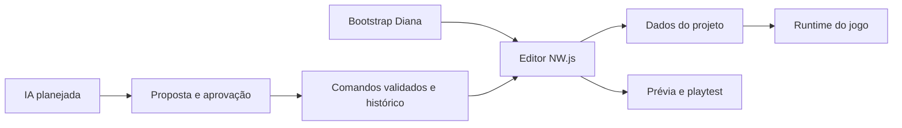

# Arquitetura Diana RPG Studio

Inspeção de fontes em 15/10/2026. Diana é uma integração sobre RPGReactor, não uma engine independente já reescrita. O pin em `upstream-lock.json` aponta RPGReactor 0.99.0, commit `dc918245cbf8f10ae6eef4ed8cb54b850fed9caa`. O checkout compartilhado pode receber alterações em paralelo; resultados executáveis precisam indicar o build e os patches realmente usados.

## Estados usados

**Implementado e testado** exige um cenário e evidência de execução. **Implementado, mas não testado** (também referido abaixo como implementado na fonte) indica código inspecionado sem aceite executado. **Parcial** indica integração ou validação incompleta. **Planejado** não representa funcionalidade entregue. **Bloqueado** identifica uma dependência concreta que impede determinado aceite. O estado atual de execução está em [VALIDATION.md](VALIDATION.md).

## Editor, dados e runtime

O editor é inicializado por `upstream/RPGReactor/editor/src/main.js`, cuja classe `RPGReactor` coordena managers, controladores e UI. Classes JavaScript existentes são os pontos reais de integração; as 11 interfaces abaixo são fronteiras de responsabilidade do projeto, **não contratos TypeScript ou SDKs Diana já publicados**.

Os dados persistidos incluem `project.rpgreactor`, `data/MapNNN.json`, registros do banco em `data/*.json` e recursos nas pastas do projeto. `ProjectManager.js` e `DatabaseManager.js` fazem leitura/gravação; helpers como `editor/src/utils/FsAtomic.js` apoiam escrita atômica. Atomicidade de um arquivo não assegura transação geral de todos os dados.

O jogo tem entrada em `upstream/RPGReactor/runtime/reactor_main.js` e consome cópias dos módulos `reactor_*.js` no projeto. `reactor_objects_interpreter.js` executa comandos de eventos; regras de ações e combatentes ficam nos módulos correspondentes. A prévia do editor não substitui validação no jogo.

## Mapeamento das 11 interfaces solicitadas

Na tabela, `E/` significa `upstream/RPGReactor/editor/src/`; `R/` significa `upstream/RPGReactor/runtime/`. Os nomes em inglês preservam a identidade dos requisitos; a descrição especifica seu papel em português.

| Interface | Editor / entrada observada | Dados / fronteira | Runtime / consumidor | Situação Diana |
| --- | --- | --- | --- | --- |
| Project Core | `E/ProjectManager.js`, `E/ProjectController.js`; `src/DianaBootstrap.js` | Criar/abrir/salvar projeto, `project.rpgreactor`, versão Diana | Projeto carregado pelo jogo | Integração implementada; cenário básico verificado por artefato |
| Asset Manager | `E/ResourceManager.js`, `E/utils/AssetFiles.js` | Recursos de imagem, áudio, modelo e demais arquivos do projeto | Carregadores do runtime e referências dos registros | Implementado upstream; fluxo Diana completo parcial |
| Map Editor | `E/MapEditor.js`, `E/TilemapManager.js`, `E/MapImageLayersManager.js` | Tiles, eventos e camadas em mapas JSON; histórico em `E/utils/MapHistory.js` | `R/reactor_objects_map.js`, `R/reactor_image_layers.js` | Implementado upstream; duas camadas persistidas no smoke, pintura GUI pendente |
| Event Editor | `E/EventManager.js`, `E/event/EventEditor.js`, `E/event/EventCommandList.js` | Páginas, condições e listas de comandos dos eventos | `R/reactor_objects_interpreter.js` | Implementado upstream; aceite Diana pendente |
| Database Editor | `E/DatabaseManager.js`, `E/DatabaseEditorUI.js`, `E/database/` | Atores, classes, itens, habilidades, inimigos e outros registros JSON com IDs | Objetos e managers do runtime | Implementado upstream; validação integrada parcial |
| Animation Editor | `E/database/DatabaseAnimationEditor.js`, `E/utils/AnimationPreviewLayer.js` | `data/Animations.json`, folhas, efeitos e temporizações | `R/reactor_sprites.js` | Implementado upstream; fidelidade Diana pendente |
| Battle Core | Configuração de dados e `E/PlaytestManager.js` | Ações, habilidades, inimigos, tropas, resultado e regras de combate | `R/reactor_objects_actions.js`, `R/reactor_objects_battlers.js` | Base upstream disponível; batalha Diana completa não verificada |
| Battle Presentation | `E/battle/BattlePresentationEditor.js`, `E/database/DatabaseActionSequenceEditor.js` | `ActionSequences.json`, `BattlePresentation.json`, validação em `E/battle/BattleData.js` | `R/reactor_battle_data.js`, `R/reactor_battle_presentation.js` | Parcial; correções de pose em desenvolvimento/validação |
| Game Runtime | `E/PlaytestManager.js`; integração de execução | Leitura dos dados do projeto e scripts `js/` | `R/reactor_main.js` e módulos carregados por ele | Runtime upstream existente; pacote Diana final pendente |
| Plugin SDK | `E/PluginManager.js` | Configuração, parâmetros e ordem; `js/reactor_plugins.js` ou `plugins.js` | `R/reactor_plugins.js` contém lista `$plugins` | Gerenciamento upstream existe; SDK Diana versionado/documentado planejado |
| Diana AI Integration | Nenhum serviço Diana de IA encontrado nas fontes inspecionadas | Propostas de comandos, contexto, validação, aprovação e histórico | Sem acesso direto do modelo ao runtime ou filesystem, conforme projeto proposto | Planejado; adaptadores OpenAI, Anthropic e local não implementados |

Uma interface formal futura deve envolver o módulo existente em adaptadores, mantendo um único caminho de gravação e regras compartilhadas com o runtime. Não duplicar banco, engine ou aplicação de dano para cumprir a nomenclatura das interfaces.

## Integração e preparo existentes

`src/DianaBootstrap.js` envolve métodos de `I18nManager`, `ProjectManager` e `UIManager`: usa português quando não há preferência, força `blank: true`, remove opção de template e persiste `diana: {schemaVersion: 1, studioVersion: '0.1.0'}`. O título da janela e idioma do documento também são ajustados. Isso não comprova tradução integral de todas as interfaces.

`scripts/prepare-editor.cjs` delega a `scripts/prepare-source.cjs`. Este confere o pin, exporta arquivos com `git archive`, aplica patches com `git apply --check`, injeta bootstrap/marca, remove template e artes de splash upstream e registra hashes em `build/diana/provenance.json`. A aplicação resultante foi executada no Windows. O diretório `node_modules` é ligado à instalação local upstream: o build preparado é de desenvolvimento e não constitui instalador distribuível.

`scripts/launch.cjs` usa `tools/nwjs-sdk-v0.118.0-win-x64/nw.exe` e `build/diana/editor`; solicitar inicialização não prova janela funcional. Não editar `build/` como fonte de verdade: alterações devem estar no bootstrap, patches ou fonte autorizada e sobreviver ao novo preparo.

## IA controlada — desenho planejado

O editor fornecerá contexto mínimo do projeto a um adaptador de provedor (OpenAI, Anthropic ou local), sem exigir infraestrutura paga própria. Provedor local também depende de instalação e disponibilidade; não é uma capacidade já entregue. Uma configuração explicará quais dados serão enviados e permitirá operar sem IA.

O modelo retornará propostas no esquema de comandos permitido, sem executar shell ou JavaScript livre. O fluxo proposto é: coletar contexto → gerar proposta → validar esquema/referências/limites e revisão-base → mostrar diff e efeitos → aprovar ou rejeitar → aplicar uma transação pelo editor → registrar undo/redo. Uma proposta obsoleta deve ser revalidada antes de alterar o projeto. Cancelamento ou falha não pode deixar escrita parcial.

`E/utils/MapHistory.js` já organiza históricos de ferramentas do mapa; `DatabaseActionSequenceEditor.js` possui undo/redo local. **Não há um histórico global Diana para IA demonstrado.** É necessário um adaptador que preserve a ordem entre edições manuais e comandos da IA, capture pré-imagens e ofereça recuperação para lotes de múltiplos arquivos.

Credenciais ficarão em armazenamento seguro do sistema, referenciadas pela configuração local, com remoção e troca de provedor. Não devem ir para `project.rpgreactor`, assets, logs ou exportações. Logs de operação devem omitir segredos. Os comandos iniciais serão pequenos e revisáveis; provedores e respostas externas não recebem autorização implícita para modificar o disco.

## Evidência e limites

`tests/bootstrap.test.cjs` contém cenários de português, projeto vazio/metadados e erro de persistência; esta tarefa leu o teste, mas não executou a suíte. `tests/upstream/diana-battle-held-poses.test.cjs` e `patches/held-poses.patch` registram a correção de seleção de coluna de pose; poses arbitrárias e resultados atuais dependem do worker de batalha.

O smoke Windows atual cobre projeto, duas camadas, pintura por ponteiro, undo/redo, importação, parallax, evento e execução do jogo. `artifacts/battle-smoke.json` cobre o formulário de poses e um cenário lateral com ataque por API. Os limites e o resultado da suíte upstream estão em [VALIDATION.md](VALIDATION.md); não há aprovação global de todos os fluxos.

Os próximos aceites estão em [TASKS.md](../TASKS.md) e os marcos em [ROADMAP.md](../ROADMAP.md). Detalhes de apresentação e efeitos estão em [BATTLE_SYSTEM.md](BATTLE_SYSTEM.md) e [ANIMATION_SYSTEM.md](ANIMATION_SYSTEM.md).
## Integração do projeto inicial e validação

`src/DianaStarterData.js` popula apenas a criação de novos projetos usando o
formato de dados e runtime Reactor. Gera sprites geométricos, piso e janela MIT;
não copia o Demo. `DianaBootstrap.js` integra essa criação, sem migrar projetos
existentes. Os arquivos são copiados e identificados por hash no prepare.

`src/DianaProjectValidation.js` é uma função de leitura dos dados de editor.
O bootstrap chama essa validação antes do playtest; erros aparecem em diálogo
português, sem alteração automática. O runtime exportado continua usando os
dados salvos e não depende desse código de ferramentas. A validação é parcial,
conforme [STARTER_PROJECT.md](STARTER_PROJECT.md).

